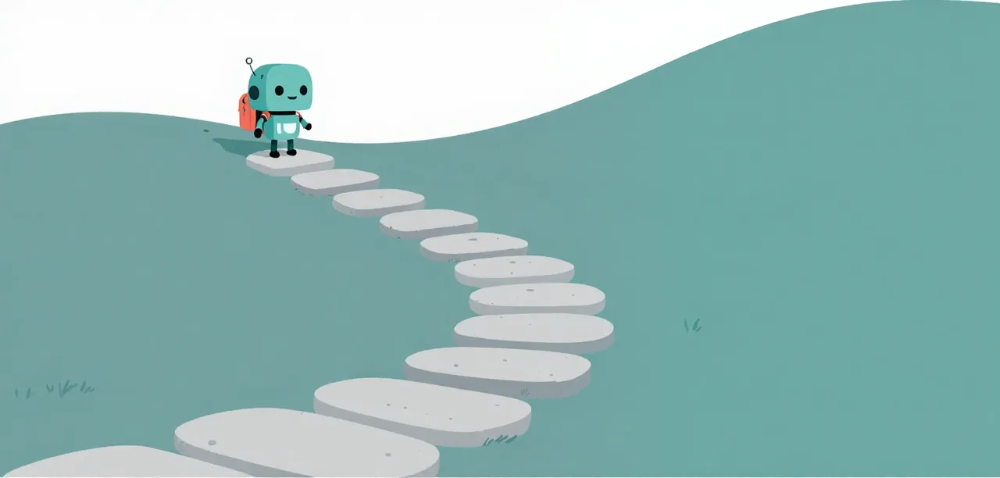

# Getting Started

This track is in a fixed order: each step builds on the one before, and
each ends with a check you can run. Five steps, then the Lessons.

{ .illustration }

## Steps

1. **[Base Pi on llama.cpp](base-pi-on-llamacpp.md)**: Install `uv`, llama.cpp and the Mellum weights, chat with the model, and connect Pi through a private profile to get an answer. You finish with a server, a `chat` command, and base Pi answering. Start here.
2. **[The ditch](ditch.md)**: Drive an open-ended AgentClinic session with base Pi and check its final report. You finish knowing why evidence comes before a fix.
3. **[Make a mini harness](harness.md)**: Write a small harness that runs Pi on a task in a fresh directory and scores it. You finish with one isolated run and a score line.
4. **[Eval suites and the telemetry](suite.md)**: Run easy, medium and hard AgentClinic suites, grade the model's files, and read why a run failed from its trace. You finish with three suites, hidden graders and a qualification.
5. **[The worker extension](worker-extension.md)**: Learn what a Pi extension is and how `/mellum` changes the prompt, tools and guards through events and callbacks.

If setup fails, use [Troubleshooting uv and llama-server](troubleshoot.md).
