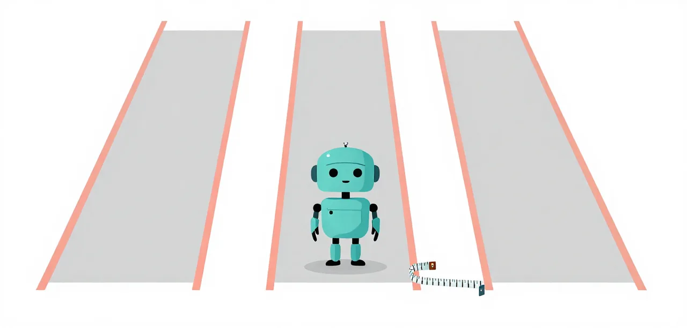

# E1 · The suite baseline

Given the whole job, a small model fails most of the suite's sessions and
never passes hard, whether it plans or only answers. The page measures the
worker boundary against that baseline, suite by suite, as the unit the other
lessons change.

!!! abstract "Overview"

    **Questions**

    - How well does a small model do on the suites with no help at all?
    - Does wrapping it in the worker boundary change that, and on which suites?

    **Objectives**

    - Read the baseline table that every other lesson is measured against.
    - Name the parts of the Baseline Worker: prompt, seven tools, guards and project facts.
    - Recognise why the parts are treated as one unit rather than separate lessons.

{ .illustration }

## Problem

**Badge:** `screen`

With Mellum as the main model, Baseline Pi passes none of the nine suite
sessions; the Baseline Worker passes three, all on easy and medium. Hard passes
none for either. The direction is the old primary-agent result, but the suite
baseline is much weaker than the rung-1–5 ladder.

## Eval case

**Badge:** `screen`

Easy, medium and hard, three sessions per suite and arm. Easy is one prompt,
medium four and hard eleven. The Baseline Worker is `extensions/mellum-worker.ts`
with the worker prompt, seven built-in tools, the empty-final nudge, the loop
breaker and project facts. Baseline Pi is the same model with no extension.

## Evidence of the problem

**Badge:** `screen`

Baseline Pi, n = 3:

| Suite | Passes | Turns | Failed checks | Tool errors | Context | Wall | Output tokens |
| --- | --- | --- | --- | --- | --- | --- | --- |
| easy | 0/3 | 15.0 | 4.0 | 3.0 | 2355.7 | 22.1 | 2931.7 |
| medium | 0/3 | 54.3 | 18.0 | 5.7 | 15128.0 | 359.2 | 33197.0 |
| hard | 0/3 | 84.7 | 29.7 | 12.0 | 25828.0 | 569.1 | 46542.3 |

Baseline Pi is not one failure repeated: easy fails quickly, medium and hard spend
minutes and still miss the hidden checks.

## Solution

**Badge:** `screen`

Give the model the worker boundary: the worker prompt, the seven tools, the
guards and the project facts.

### The code

Reduced from `extensions/mellum-worker.ts`. Activation saves the parent’s
model and tools, switches to the worker model, narrows the tool set and
creates the guards:

```ts
const previous = { model: ctx.model, tools: pi.getActiveTools() };
const switched = await pi.setModel(model);
if (!switched) return;
saved = previous;
pi.setActiveTools(WORKER_TOOLS);
active = true;
guards = createGuardSet();
```

The request hook installs the worker prompt and filters the messages; the
guard hook keeps the call decisions in the same extension:

```ts
pi.on("before_provider_request", (event, ctx) => {
  if (!active) return undefined;
  return filterForMellum(event.payload, prompt, {
    expectMarker: interactive,
    facts: factsBlock(spanFacts),
  });
});

pi.on("tool_call", (event) => {
  if (!active || !guards) return undefined;
  return guards.toolCall(event);
});

pi.on("agent_before_settle", () => {
  if (!active || !guards) return undefined;
  return guards.beforeSettle();
});
```

The full file is [`extensions/mellum-worker.ts`](https://github.com/pauleveritt/mellum-worker/blob/main/extensions/mellum-worker.ts);
the wrapper invokes it with `learn/code/clinic "/mellum <task>"`.

This is the Baseline Worker. The parts were screened by removing them one
at a time; the screen did not support lessons for them.

## Validation

**Badge:** `screen`

### Evidence of the solution

n = 3, same suites, same machine, llama.cpp:

| Suite | Arm | Passes | Turns | Failed checks | Tool errors | Context | Wall | Output tokens |
| --- | --- | --- | --- | --- | --- | --- | --- | --- |
| easy | Baseline Pi | 0/3 | 15.0 | 4.0 | 3.0 | 2355.7 | 22.1 | 2931.7 |
| easy | Baseline Worker | 1/3 | 26.7 | 2.0 | 4.0 | 7834.0 | 78.6 | 8978.3 |
| medium | Baseline Pi | 0/3 | 54.3 | 18.0 | 5.7 | 15128.0 | 359.2 | 33197.0 |
| medium | Baseline Worker | 2/3 | 47.7 | 6.0 | 5.7 | 7421.7 | 204.1 | 22507.7 |
| hard | Baseline Pi | 0/3 | 84.7 | 29.7 | 12.0 | 25828.0 | 569.1 | 46542.3 |
| hard | Baseline Worker | 0/3 | 108.3 | 20.7 | 17.0 | 17157.7 | 540.8 | 49524.0 |

### What the telemetry shows

The Baseline Worker separates on easy and medium by passes (0/3 to 1/3 and
0/3 to 2/3), and cuts failed checks on both. It does not separate on hard: no
arm passes and the worker spends more turns and tool errors while still
failing. The worker's context is lower on every suite, so the gain is not
from seeing more.

An earlier screen removed the prompt, the empty-final nudge and the loop
breaker one at a time. The prompt and loop breaker did not separate; removing the
nudge was a lead (3/3 easy against 1/3), not a rate. The parts are therefore
not separate lessons. The [screen](https://github.com/pauleveritt/mellum-worker/blob/main/docs/superpowers/research/2026-10-21-basic-remedies-runs.md)
keeps the null result; the Baseline Worker is the unit.

### Checks

Both suites are qualified: `known-good` passes and `known-broken` fails. The
run JSON, not the final reply, carries the table. Static grading is not part
of this comparison.

## Interpretation

The weakest badge is `screen`: one backend, one model, one machine, n = 3. The
parent here is also Mellum, so this isolates the worker role, not what a large
parent gains. Hard has no headroom, and the Baseline Worker is not a remedy
there. What transfers is the shape: the worker boundary helps on easy and
medium; the component screen did not justify separate lessons.

### Run it yourself

Run Baseline Pi (`bare`) and the Baseline Worker (`worker`) on all three suites, three sessions each:

```bash
uv run python learn/code/harness.py run --suite all --arm bare --repeat 3 --grade --deadline 600
uv run python learn/code/harness.py run --suite all --arm worker --repeat 3 --grade --deadline 600
```

!!! success "Key points"

    - Baseline Pi passed none of nine sessions; the Baseline Worker passed three, all on easy and medium (a screen, n = 3).
    - Hard passed for neither arm, so the worker is not a remedy there.
    - The worker's context was lower on every suite, so the gain is not from seeing more.
    - Removing parts one at a time did not separate them; the Baseline Worker is the unit.
