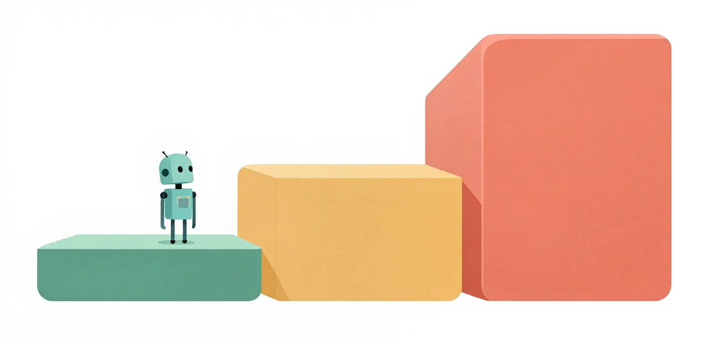

# Lessons

Each lesson takes one thing a small coding model gets wrong, measures it, and
shows what changes it. The lessons are grouped in three tiers that rise in
level, and every lesson stands on its own: [Getting started](../getting-started/index.md)
is the only thing you need first, unless a lesson's prerequisites say
otherwise.

{ .illustration }

-   **[Easy](easy/index.md)**

    ---

    One setting, one visible effect. You read the result in a table, and you
    can follow it from Getting started alone.

-   **[Medium](medium/index.md)**

    ---

    How the model spends its session: its thinking, its empty turns, the
    shape of the task it is handed. You will read a trace.

-   **[Hard](hard/index.md)**

    ---

    Orchestration and advanced concepts: who drives the model, how work is
    split, checked and re-dispatched.

The lessons' runs use the Bronze, Silver and Gold levels of
[The Challenge](../challenge/index.md). A lesson's tier says how far into the
material it goes, not which level it runs on.

## How every lesson reads

Every lesson page has the same shape, so you know where to look:

1. **Two sentences:** the problem and the solution.
2. **Overview:** the questions the lesson answers and what you will be able to
   do after it.
3. **Six steps:** Problem, Eval case, Evidence of the problem, Solution,
   Validation, Interpretation. Each step carries its own evidence badge
   ([what the badges mean](../about/evidence.md#badges)).
4. **Run it yourself:** the command that reproduces the lesson's arms, or a
   plain statement that it has none yet.
5. **Key points:** what to take away, never stronger than the evidence.
