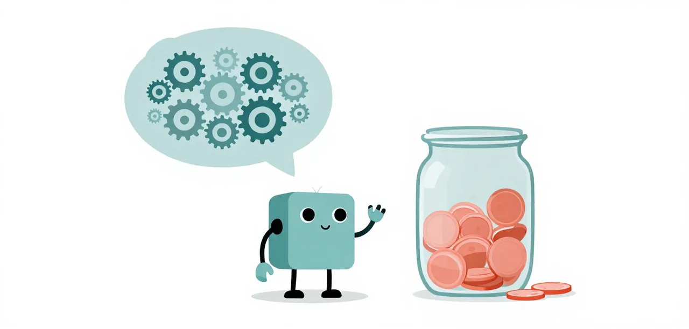

# M1 · Thinking Is Working Memory

Stripping a reasoning model's thinking blocks looks like a cheaper prefill,
but the output cap is the budget that binds and the worker's guards read those
blocks. This page keeps them and names the arm that would settle the
question.

!!! abstract "Overview"

    **Questions**

    - Does stripping a reasoning model's thinking blocks from the forwarded context save anything?

    **Objectives**

    - Explain why the output cap, not the prefill, is the budget that binds for a reasoning model.
    - Recognise a final ended by `length` as an output cap spent on reasoning.
    - Name the arm that would settle whether stripping thinking helps on llama.cpp.

{ .illustration }

## Problem

**Badge:** `screen`

A reasoning model writes before it answers, and the worker forwards those
blocks back to the model on the next request. Stripping them is the obvious
saving: the payload gets smaller and the prefill gets cheaper. The story
this page used to tell is that the saving is an illusion: you pay again in
output tokens, and sometimes in passes.

On llama.cpp that story now has an instrument but **no result yet**. It is kept here because the
mechanism matters and because the page is the honest place to say so.

## Eval case

**Badge:** `conjecture`

The worker now has the seam: `MELLUM_STRIP_THINKING=1` removes earlier
reasoning from the context it forwards, and the harness turns it on with
`--arm strip-thinking`. The arm that measured it before was a request-layer
middleware in the ladder, which rewrote outgoing payloads. The settings the worker does expose (prompt, guards, facts)
say nothing about thinking, and `llama-server` is served with thinking on.

So the eval case this page wants is: Bronze and Silver, the first two levels
of [The Challenge](../../challenge/index.md), three sessions each,
`worker` against `worker` with every prior assistant `reasoning` block
removed from the forwarded context. It has not been run yet.

## Evidence of the problem

**Badge:** `screen`

What is measurable here is narrower: **thinking spends the output budget.** A
one-turn smoke against the running server, `max_tokens 32`, returned
`content: ''` with 32 completion tokens spent and `finish_reason: stop`: the
whole allowance went to reasoning. At `max_tokens 200` the same prompt
returned its reasoning and then `ready`.

The suites show the same budget being hit in anger: the failing runs in this
cycle's records include finals ended by `length`, the output cap, on both Bronze
and Silver. An output cap spent on reasoning is a run that never reached its
answer, and no guard of this worker's shape can answer it.

None of that measures the saving from *keeping* thinking. It measures the
cost of the budget it draws on.

## Solution

**Badge:** `screen`

Keep the thinking blocks. Three reasons, in the order they matter:

1. The cap is the budget that binds: at `max_tokens 16384`, a run that spends
   its allowance reasoning ends empty, and stripping earlier thinking does not
   give that allowance back.
2. The extensions that need them read them: the loop breaker judges
   repetition from what the model said, and the nudge continues a turn it
   ended.
3. There is no measured case on this backend for removing them.

If a future arm shows stripping helps, this section changes. That is what the
page is waiting on.

## Validation

**Badge:** `conjecture`

### Evidence of the solution

| Suite | Arm | Passes | Peak input | Wall | Status |
| --- | --- | --- | --- | --- | --- |
| Bronze | `worker` | n/a | n/a | n/a | not run yet |
| Silver | `worker` | n/a | n/a | n/a | not run: same |

A missing measurement is `n/a`, never `0`.

## Interpretation

The weakest badge is `conjecture`, and this page is deliberately thin: it
names a mechanism, a cost and an arm that has not been run. The numbers it used to
quote (a 57% prefill saving and a slower run) came from oMLX ladder arms and
are retired here rather than re-stated.

What survives is a testable shape: on this backend, prefill is cheap because
the layer cache absorbs the repeated prefix, so removing thinking from the
payload mostly moves cost from prefill into output. The suites can show that,
now that the payload seam exists.

What would upgrade this: run the arm above, at n = 3 on Bronze and Silver.
Until it has run, this page should be read as a question, not a finding.

### Run it yourself

Run the worker with and without earlier reasoning in its context, on Bronze and Silver, three sessions each. No result is recorded yet, so yours would be the first:

```bash
for suite in easy medium; do
  for arm in worker strip-thinking; do
    uv run python learn/code/harness.py run --suite "$suite" --arm "$arm" --repeat 3 --grade --deadline 2700
  done
done
```

!!! success "Key points"

    - Thinking spends the output budget: at `max_tokens 32` the whole allowance went to reasoning and the content came back empty.
    - Keep the thinking blocks; the guards read them and there is no measured case on this backend for removing them.
    - The old 57% prefill saving came from oMLX ladder arms and is retired here.
    - The badge is `conjecture`: read this page as a question, not a finding.
